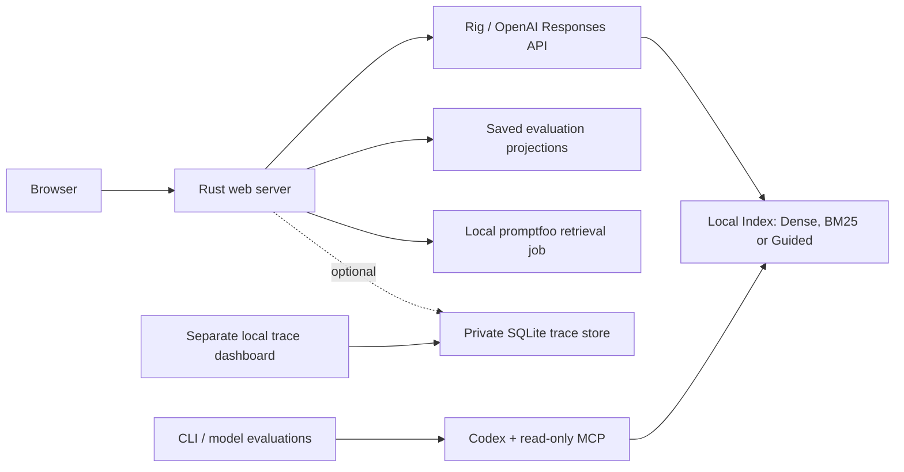

# Codebase guide

This guide explains the current website and the boundary between new model answers and saved evaluations. Start with the [interactive code tour](code-tour.html); use the [runtime report](runtime-report.md) for dated verification and known limitations. [Local setup](LOCAL_SETUP.md) covers installation, [privacy](privacy.md) covers data handling, and [the evaluation index](../evals/README.md) routes experiments.

The explanation page embeds the Dutch and English architecture diagram. Its editable two-page source is [how-it-works.drawio](diagrams/how-it-works.drawio); keep its geometry and inline SVG versions consistent. The RAG frame contains the search index and search function, with the answer model outside that frame.

## One website, separate execution paths



CLI/MCP processes build separate index instances: they share the retrieval implementation and selected corpus, not the web server’s RAM index.

The application is Rust. Browser assets remain JavaScript/HTML/CSS; owned evaluation tools are TypeScript. Node.js and Codex are not website dependencies. Evaluation modules remain in the same Rust crate through `#[path]` declarations, while their source and evidence live under `evals/`.

[`main.rs`](../src/main.rs) starts `serve` by default, loads the live corpus/index and passes it to [`web::serve`](../src/web.rs). `WebState` binds to loopback, port 8766 unless `COA_PORT` overrides it. Assets are embedded with `include_str!`; changing one requires rebuilding and restarting. There is no general file server exposing the checkout or raw experiment directories.

| Route | Behavior |
| --- | --- |
| `/` | Live demo: fictional sources, a free-text question, answer and actual search actions. |
| `/demo`, `/demo/` | HTTP 308 redirect to `/`. |
| `/techniek/` | Human explanation of the architecture. |
| `/resultaten/` | Eleven source-quality questions plus T05 and separately opened saved results. |
| `/benchmark/` | One evaluation question across all applicable variants, with two repetitions and required-source coverage. |
| `/api/session`, `/api/runs`, `/api/runs/{id}` | Create a session, submit a question, poll its run. |
| `/api/evals/rag` | Read the curated saved promptfoo projection. |
| `/api/evals/rag/catalog`, `/api/evals/rag/runs` | Read the fixed local test catalog; start/read/cancel an owned local evaluation job. |
| `/api/benchmarks/catalog`, `/api/benchmarks/plan`, `/api/benchmarks/runs`, `/api/benchmarks/compare` | Plan existing evaluation matrices, queue/cancel durable local runs and compare shared cases. |
| `/api/benchmarks/questions/plan`, `/api/benchmarks/questions/start` | Plan/start one current question; explicit start requests require a durable idempotency ID. |

Hosting adds a separate route allowlist; the local evaluation worker is not a supported public endpoint. See [deployment](public-deployment.md).

`COA_TRACE_DB` optionally records projected model/search events through [`traces.rs`](../src/traces.rs), with random thread IDs separate from visitor bearer sessions. [`trace_dashboard.rs`](../src/trace_dashboard.rs) serves a read-only dashboard through `traces serve --db PATH [--port 8767]`. This command dispatches before index/key/answer-service initialization, binds only to loopback, checks Host/Origin and exposes its own thread list/detail/JSON export routes. The visitor router has no trace-reading routes. See [trace setup](traces.md) for captured fields, retention and private access.

## Trace one question

[`demo.js`](../static/site/demo.js) creates a session, posts a question and polls its run. `POST /api/runs` captures the question and `answer_language` (`nl`/`en`, default `nl`) before starting background work. The server fixes every new run in the twelve-activity demo to Guided search. Older clients can still send the valid `retrieval_method` values. Other local corpora retain their Dense and BM25 request handling. Local replay uses the original method and source context, including the Guided policy version.

[`ResponsesRunner::run`](../src/responses.rs) delegates model/tool steps to Rig in [`rig_runtime.rs`](../src/responses/rig_runtime.rs). The agent registers only the typed `SearchTool`, native structured-answer schema and `RunPolicy` hooks. Rig owns the agent loop; COA does not run a second competing loop.

The request goes to OpenAI's Responses API with `gpt-6.1-sol`, reasoning `low`, service tier `default` and `store: false`. The web prompt shares language, source and prompt-injection rules with [`codex.rs`](../src/codex.rs); the question is a separate input data item. The only model tool is `search_document(query, top_k, search_goal)`. It cannot access shell, arbitrary files, URLs, web search, Codex or a code-mode host. This is local function calling, without MCP transport in the web path.

The first model call must perform a real source search. The model can then make focused follow-up searches. `search_goal` is a public one-line task label, 1–80 characters, supplied by the model for that executed action; it is not private reasoning or a result claim. It is added to web JSON only after source/answer validation. Older runs and the shared Codex tool-call schema do not receive invented goals.

The fixed callback invokes [`Index::search_for_method`](../src/lib.rs). A mutex protects the shared index only during the short local `spawn_blocking` search; model HTTP requests wait independently. The website does not start ten model copies or ten Codex processes. The selected search method is server context and cannot change between tool calls.

Rig preserves original input/output items for subsequent calls, including encrypted reasoning, assistant phases and matching `function_call_output`, without `previous_response_id`. This replay exists only in the run's RAM; raw/encrypted reasoning is absent from public records. Only the final answer is interpreted as the answer. Refusals, incomplete responses, unknown tools, malformed arguments and invalid final JSON fail the run.

`validate_retrieved_answer` checks that source IDs, dates, manifests and exact citation text agree with passages actually returned. Repeated section IDs are namespaced by document. This proves provenance, not that every conclusion follows from the evidence. Missing evidence and honest unknowns remain possible even when the run completes.

## Bound transport and spending

[`BoundedTransport`](../src/responses/transport.rs) implements Rig's `HttpClientExt` and enforces the application policy before the codec. Original generation bytes are sent unchanged. Redirects, streaming and multipart are disabled on this route; invalid typed tools fail through a hook.

| Limit | Current contract |
| --- | --- |
| Whole run | One 120-second deadline, including counting, body reads and retrieval. |
| Tool work | At most four searches; after the fourth, tool choice is `none`. |
| Model work | At most five generations and five free exact input-token preflights; no automatic retries. |
| Tokens per generation | At most 300,000 counted input tokens and 4096 output tokens, including reasoning. |
| Bodies | 512 KiB provider response, 1 MiB serialized request context, 16 KiB count response. |
| Search input | Query 1–1000 characters; top-k 1–6; tool arguments at most 16 KiB; unknown fields refused. |

Each attempt receives a durable, atomic reservation in the schema-2 budget **before** input counting. The count includes all token-bearing fields, tools, schema and encrypted replay; unknown fields or invalid counts stop generation. Model, Standard pricing tier, `30m` cache policy and output ceiling stay fixed. Missing/corrupt/replaced/unwritable state fails closed. Restarts preserve usage; the same budget cannot be opened concurrently. [`demo_budget.rs`](../src/demo_budget.rs) owns this policy; [setup](LOCAL_SETUP.md#token-and-price-assumptions) records price assumptions and initialization.

`ResponsesRunner::from_env` reads an inherited nonempty `OPENAI_API_KEY`, an explicit external `COA_OPENAI_API_KEY_FILE`, or finally `OPENAI_API_KEY` from `.env` in the current working directory, in that order. The external key file must be regular, owned by the user, without links or group/other access, and bounded to 4096 trimmed bytes. The `.env` parser does not mutate the process environment or import budget/other settings; `COA_DISABLE_DOTENV=1` skips it. Start from the project root and keep `.env` private and untracked. Public configuration exposes neither key nor path, and parser errors omit file contents. Missing setup permits source/result browsing with answers unavailable, without a Codex fallback. `runtime_ready` means configured, not proven quota or credit. The debug-only loopback mock uses a fixed fake key and does not read `.env` or a real key; release builds refuse that override.

New run metadata identifies `provider: openai`, `transport: responses_api`, `runtime: rig-0.46.0` and matching `client_version`. Successful runs sum available usage across provider requests; reasoning tokens are part of output. Missing usage remains unknown. Failed runs may already have incurred charges. These records are not a billing ledger, and a local timeout cannot guarantee provider cancellation.

## Corpus and retrieval contracts

The demo uses Guided search in two steps. It ranks passages by meaning and exact words, then checks whether the question contains conditions it can apply directly to activity records. For a recognized list question, that second step can inspect all twelve activities and replace the ranked passages.

### Follow an afternoon question

Use “Welke activiteiten zijn in de middag?” to see the difference. On the website, Rust fixes the method to Guided. The answer model supplies the query text to [`search_document`](../src/responses/rig_runtime.rs#L129), so its search calls may differ from what the visitor typed. The [source-only CLI](../src/main.rs#L120) passes the supplied query directly to the same retrieval code and prints the search result as JSON.

```sh
cargo run --locked -- search --corpus demo-twelve --method guided 'Welke activiteiten zijn in de middag?'
```

This runs local MiniLM retrieval and requires no answer model, provider key or spending budget. See [local setup](LOCAL_SETUP.md) for the embedding cache. CLI `search` defaults to Dense when no method is supplied. `search` and `ask` default to the original five sources when no corpus is supplied. Guided requires `demo-twelve`.

### Prepare sections and activity records

[`CorpusId::DemoTwelve`](../src/corpus.rs) selects twelve fictional documents with six sections each and a reference date of **13 November 2026**. The first ten preserve `ExpandedTen` bytes. Schaken and Naaicafé have their own source IDs and dates. The [parser](../src/source.rs#L50) accepts at most twelve documents and rejects missing or duplicate IDs, invalid dates, empty headings or sections, and duplicate section IDs within a document. Each passage retains its document ID, section ID, title, heading and source date.

[`Index::load_for_corpus`](../src/lib.rs#L138) keeps the sections and their vectors in memory. The local quantized multilingual MiniLM encoder uses fastembed 7.1.2, produces 384 numbers per passage and has a 512-token input ceiling. Its passage input joins the activity title, heading and exact text with newlines, without prefixes. The manifest records hashes for the corpus, embedding inputs and vectors, plus the model and encoding identity. Model download revisions and platform differences can affect the vectors.

On the first Guided search, [`PreparedCorpus`](../src/retrieval/mod.rs#L100) groups the sections by activity, and [`activity_records`](../src/retrieval/metadata.rs#L66) reads explicitly stated schedules and venues. In [Tuinieren](../fixtures/document.md#L12), “Iedere dinsdag van 10.00 tot 12.00 uur.” becomes Tuesday with a start and end in minutes since midnight. Each parsed value stays linked to its source text. Missing or conflicting values remain unknown. A published schedule gives the activity hours. Available places require separate evidence.

### Word scores, vector scores and starting passages

[`retrieve`](../src/retrieval/engine.rs#L112) computes two scores per section. **BM25** lowercases the title, heading and text and looks for exact Unicode word matches. Terms that occur in fewer sections count more. Repeated words also affect the score, with diminishing returns and an adjustment for section length (`k1=1.2`, `b=0.75`). The tokenizer uses whole words without stemming. **Dense search** embeds the query with MiniLM and compares its vector to each section vector using cosine similarity. This helps related wording rank even when the exact query word is absent.

Guided takes up to 30 candidates from each ranking, with positive scores required for the BM25 list, and joins the two lists. It puts cosine on a 0–1 scale using `(cosine + 1) / 2`. It divides each BM25 score by the best positive BM25 score, or uses zero when there is no such score. The final score is **70% scaled cosine plus 30% scaled BM25**. These are ranking scores. Pure Dense and BM25 expose `similarity` and `bm25_score` respectively. BM25 does not embed the query, although the shared website index loads MiniLM at startup.

The [Guided configuration](../src/lib.rs#L280) caps the initial selection at three sections, called *seeds*. Activity expansion adds whole sections from those activities as space permits. The **1,200 estimated section-token** limit counts the characters of each section’s JSON, divided by four and rounded up. That is a search-side estimate per call. The provider’s exact input count covers the full model request.

### Check the conditions in the query

After ranking, [`read_intake`](../src/retrieval/intake.rs#L470) lowercases the query, splits it into words and looks for supported Dutch and English word patterns. “Welke activiteiten” requests a list. “Middag” supplies the afternoon time window. In `dinsdagmiddag`, the [weekday rule](../src/retrieval/intake.rs#L515) uses `strip_prefix` to recognize `dinsdag` followed by the allowed suffix `middag`. The [separate time rule](../src/retrieval/intake.rs#L431) uses `ends_with("middag")` to set the afternoon condition. The two conditions then apply together. Other supported wording can specify a start time, an activity already underway, indoors or outdoors, an address, free participation, supplied materials or a comparison between named activities.

[`check_time`](../src/retrieval/intake.rs#L1049) tests for overlap with 12:00–18:00 using `start < 18 * 60 && end > 12 * 60`. [Samen koken](../fixtures/community-cooking.md#L10) runs from 11:00 to 13:00 and overlaps the afternoon. Tuinieren ends at 12:00 and has no overlap. Asking for `dinsdagmiddag` also requires Tuesday, so Samen koken on Friday falls out and [Fietsen opknappen](../fixtures/bicycle-workshop.md#L10) on Tuesday from 14:00 to 16:00 qualifies.

For the afternoon list, [`apply_intake_policy`](../src/retrieval/intake.rs#L1494) checks every activity against the recognized conditions. A named comparison can restrict that loop to the named activities. A known mismatch excludes an activity. With no known mismatch, an unresolved condition leaves it unknown. Guided assembles whole bundles of original sections for the relevant details, such as `S2` for the schedule and `S3` for the location. The afternoon query can return seven schedule passages even though the baseline started with at most three seeds. For single-option requests, Guided can instead use the ranking to choose among matches.

### Read the result and its limits

The [search result](../src/lib.rs#L315) contains original `hits` and a `guided_selection` report. `applied` indicates whether Guided used the structured selection. `matches` lists matched activity IDs with delivered evidence. `unknown` records unresolved activities. `exhaustive` requires a list request or a recognized named comparison, satisfied evidence requirements for the applied conditions, no unresolved activities and room for the required bundles. The current policy version is checked against each completed Guided search before the web run is stored.

Morning and afternoon have explicit time rules. For “Welke activiteiten zijn in de avond?”, there is no evening condition, so Guided returns ranked passages with `applied: false`. A query such as “Welke activiteiten zijn op dinsdag in de avond?” can still activate the Tuesday condition alone. Completeness applies to the conditions the code recognized. Ordinary excluded activities also usually contribute no passages, although named comparisons and exact-start near misses can supply exclusion evidence. An empty list can therefore lack the source passages needed to support a claim that nothing fits.

The [Guided source-only checks](../evals/rag/docs/guided_demo_holdout.md) send fixed queries and measure which original passages arrive. The [language-pair procedure](../evals/rag/docs/guided_language_pairs.md#guided-v5-candidate-regression) includes the v5 route. [Selector tests](../src/retrieval/intake.rs#L1666) check list matches and requested sections. Other cases check [unknown venues](../src/retrieval/intake.rs#L2179) and [required bundles left out under a smaller budget](../src/retrieval/intake.rs#L2543). These checks establish source delivery and selector behavior for the tested inputs. The final answer and the model’s choice of follow-up searches require separate evaluation.

The retrieval lab also offers reciprocal rank fusion, weighted hybrid methods and document or SQLite profiles. Both stores feed the same canonical sections and vectors to the same Rust scorer. The lab accepts explicit typed filters in its requests and preserves unknown source fields. Expected sources and case IDs stay on the evaluation side. See [retrieval procedures and metrics](../evals/rag/docs/retrieval-lab.md) for the lab settings.

## Sessions, concurrency and network limits

A semaphore allows ten active model questions; the eleventh gets HTTP 429 without a hidden queue. Each session can have only one pending run. The permit is released on completion, failure or timeout. `RunStore` uses random 256-bit session tokens and limits RAM to 256 sessions, 40 runs per session and 256 total runs. Each run is at most 256 KiB serialized, reserving space for assessment metadata.

Sessions expire 30 minutes after creation or the latest started question. API access performs cleanup; pending runs are protected and polling does not extend the lifetime. Capacity eviction removes only inactive sessions/completed runs after input validation. Dynamic API responses, including errors/reports, use `Cache-Control: no-store`. Restart removes application RAM, not swap, downloads or provider copies.

[`DemoLimits`](../src/demo_limits.rs) allows ten started questions per network address and one hundred across the demo in a rolling hour. Starts and replays share both counters across sessions. If both quotas apply, the network quota determines the wait. Hourly rejections return HTTP 429, the code `ip_rate_limit` or `demo_rate_limit`, and the wait in both `Retry-After` and `retry_after_seconds`. Session creation has its own limit of thirty per network address in ten minutes. Questions started in the same session must be at least five seconds apart. A concurrent capacity rejection has no predicted wait.

Identity comes from the TCP peer, normalizing IPv4-mapped IPv6 and IPv6 to /64. `X-Forwarded-For` is ignored. Only an exact `COA_TRUSTED_PROXY_IP` peer may supply a single valid `X-Real-IP`; missing/invalid values are refused. The proxy must overwrite the header. Counters hold at most 4096 addresses in RAM, are not written to run records/reports/logs, and expire on subsequent checks or restart. A full table refuses a new address. Shared wifi shares limits; this is neither user identity nor an account-wide spending cap.

## Browser behavior

The demo shows compact expandable activities, one question, the literal answer and inspected search actions. Each action retains its exact query, ordered hits and any repeated passages. Citation highlights refer to the same document, date and section. IDs, top-k, similarity scores and internal statuses are not displayed as answer content. There is no separate unknowns list or judgment flow; backend fields remain available.

The language menu selects Dutch/English UI and the language of **new** answers. `localStorage['coa-demo-language']` stores the preference; unknown/blocked storage falls back safely. `sessionStorage['coa-test-session']` stores the current session ID. Changing language sends no model/search request and preserves question text, opened sources and existing answers. Source paragraphs and exact quotes remain Dutch. Activity names and section headings are translated screen labels. Shared navigation/footer follow the language preference. `/techniek/` uses the same preference for its two-question index, embedding/RAG explanations and diagrams.

## Retrieval tests and saved results

The twelve visible local browser cards use eleven audited quality questions (RAG26-01–10 plus IND26-01) and T05 on the current twelve activities (72 sections), top-k 5 section seeds, candidate-k 30, context ceiling 1200 estimated tokens and `documents_sections`. P01/T02 compatibility routes retain their original source criteria. Their encoder choice is real MiniLM or multilingual E5 Small, with E5 `query: ` / `passage: ` prefixes; BM25 loads no encoder. The separately reviewed `demo-12-20261118` development/regression set binds these questions to the current corpus; it is not human ground truth.

[`eval_jobs.rs`](../src/web/eval_jobs.rs) runs only the fixed promptfoo browser configuration and source assertions. Start/cancel requires loopback without forwarded headers, valid Host/Origin and an owned session. One heavy job at a time, no queue, 300 seconds, sixty starts/hour and five/minute per address bound local work. Fixed argv and a cleaned child environment prevent request input from choosing commands, paths, model URLs or a model-generation route. PID/start identity protects detached-child cleanup. Raw output stays under ignored `results/local/browser/`.

Promptfoo controls RAG questions/configurations/repetitions/assertions; Rust performs local retrieval or explicitly bounded Codex sessions. Protected expectations are loaded only by assertions. [`run_promptfoo.mjs`](../evals/rag/scripts/run_promptfoo.mjs) exports a public allowlist projection, excluding raw configs, machine paths, credentials and private reasoning. Source quality, N/A and execution failures stay distinct. Native retrieval time and promptfoo elapsed time have different labels.

The historical sixty sessions use `strengthened-10-20261106`, ten questions, Sol/Luna and three repetitions, both with dense retrieval over sixty sections. Model/repetition selection reads saved records and starts nothing. Six earlier aborted attempts stay separate. Source completeness is not answer correctness.

[`export_site_results.ts`](../evals/rag/scripts/export_site_results.ts) validates sealed source artifacts, record hashes and native assessments before exporting questions, valid alternative source combinations, fictional source text, model/repetition, observed searches and completion timing. It excludes raw reasoning, prompts, authentication and local paths. Browser text is inserted as text nodes; only retrieved expected support receives a success mark, and other hits are not automatically wrong.

```sh
node evals/rag/scripts/export_site_results.ts --experiment-dir /path/to/existing/frozen/run
node --test evals/rag/scripts/export_site_results.test.ts
```

Exporting/reassessing saved records makes no model calls. New web answers do. Expectations never enter the live prompt, search index or stop decision. Complete-assistant generation/judging remains separately documented under [evals/coa-assistent](../evals/coa-assistent/README.md).

## Benchmark workbench

Local benchmark scheduling admits at most two independent question jobs. Configuration and repetition order inside each job remains serial. A job containing authorized model work reserves both slots exclusively; its existing ledgers and limits are unchanged. Cancelling a queued job releases its wait without starting native work. Scheduling provenance records the configured limit, actual worker start/end and the IDs observed running at start. Parallel timings can include shared CPU/I/O contention and are not isolated model-speed measurements.

[`benchmarks.rs`](../src/web/benchmarks.rs) exposes loopback-only catalog, plan, execution, cancellation and comparison routes. Requests must use the local host and no proxy headers; mutations additionally require its matching Origin. [`adapter.ts`](../evals/benchmark/adapter.ts) obtains the exact existing promptfoo matrices and runs their original CLI adapters, or the native complete-assistant harness. It changes no scoring rules and passes no expectations to retrieval or generation. Numerical settings come from the selected canonical protocol, rather than an unbounded Cartesian product. The typed browser route binds every current question to its dataset/corpus and real MiniLM/E5 document/query encoders. Native matrices retain their pinned MiniLM encoder.

The current page selects one question by title, a RAG/current-assistant mode, and one to three fresh repetitions (default two). An Evals Benchmark click posts its exact dataset/case identity to `questions/start` and then navigates to the returned run. `request_id` and the request payload are persisted atomically before dispatch; the same request returns its existing run even after restart, while reusing an ID for different settings fails. Page loads only read `?run=...`; a bookmark, reload or history visit cannot start work. RAG uses the context-quality matrix, already a superset of ordinary retrieval settings, plus applicable browser variants: thirty-three configurations per current question in a SQLite build. The broader multi-case/historical APIs remain compatible without bulk controls in this flow.

The eleven quality selections are references in [`rag-quality-12-20261120.json`](../evals/shared/selections/rag-quality-12-20261120.json), not rewritten gold. With SQLite each current question has 24 native quality variants and nine browser variants, including two E5 dense k3 configurations with/without expansion: 33 variants and two fresh repetitions. Storage organized by activity is flattened before section ranking; top-k counts section seeds. The directly measured `query_total_ms` starts before query-vector lookup/inference on a prepared index and ends after ranking/expansion/context. Preparation is separate and potentially overlapping; historical totals are not reconstructed.

[`benchmark_sources.rs`](../src/web/benchmark_sources.rs) adds a display-only `required_source_coverage` projection to each recorded row. It follows that row's actual call-hit keys to captured text, verifies canonical source/date/text and corpus binding, and counts unique required sections in a sufficient AND/OR proof plan. Shared payload storage never combines evidence from different repetitions. Expected text added for inspection and citation metadata do not count. Found/missing source sections are separate from fact goals: the regression has eight sections and ten goals. These incomplete relevance labels do not establish universal recall or precision; the existing scorer remains unchanged.

The same projection exposes `actual_retrieval` counts of unique activities and canonical sections in all actual payloads, including unneeded sources. The comparison uses property rows and separate accessible repetition tabs. Technical errors keep unknown metrics. Independent local browser configurations continue after a failed preparation, recording the actual attempt as an error while leaving the group failed. [`benchmark_attempts.rs`](../src/web/benchmark_attempts.rs) can annotate an older missing error from its retained native record and exact planned configuration, without modifying the original results, progress or status. Truly unstarted configurations remain unexecuted.

One benchmark executes at a time, with at most three accepted active/queued runs, at most 5000 planned rows and three repetitions. Results, source references, the immutable selected plan and identity hashes remain private under ignored `evals/benchmark/results/local/` (or `COA_BENCHMARK_DIR`). Snapshot replacement and progress checkpoints are durable; an exclusive lock prevents two servers owning the same directory. Reload reconnects to the same run. Restart marks unfinished work interrupted and never retries a model. Cancellation stops the owned process tree, retaining completed evidence and budget reservations. Historical datasets, raw artifacts and public projections are not rewritten.

Local execution needs the documented Node/promptfoo prerequisites; SQLite profiles require a SQLite-enabled application build. Model suites have no default authorization: explicit positive Codex-session/time limits and the original ledgers/gates remain required. A Codex session can contain multiple provider requests. The fixed model comparison stops after its four pilots; continuing requires the original ledger and an independently approved pilot. The native complete-assistant route remains Codex, with its existing forty-generation ledger ceiling. The separate current-assistant suite uses the same `ResponsesRunner`/Rig chain, search callback and durable attempt-budget instance as the demo. Its explicit physical-attempt limit is separate from Codex session limits. There is no default spending authorization. AI judgments are not started by this page.

Comparison matches shared cases only when corpus, questions, protected criteria, scorer and protocol identities agree. Configurations and runtime revisions may differ; their hashes remain recorded as experimental provenance. Coverage counts make partial overlap visible; N/A, missing results, execution errors and failed source checks remain separate. Retrieval completeness, assistant hard checks and transport bytes have separate groups; timing scopes and unknown costs are not merged into a universal score.

### Current complete-list regression and terminal discussion

The active question catalog contains both the unchanged seventeen-case development set and the independently agent-reviewed single-case `regression-12-20261118` set. Its reused `IND26-01` visitor question asks for every indoor, free activity starting at 14:00 with materials supplied. The exact matches are the bicycle workshop and language café; eight unique source sections establish their requested properties, times and activities. Fixed source expectations include real alternative evidence and do not flow into search, prompts or stop decisions. Retrieval misses remain failures rather than being repaired by relaxed labels.

The current Rig suite executes the selected question using its supported dense/BM25 configurations; the compatibility API also retains multi-case execution. The seventeen development cases receive source/trace/citation checks, with semantic answer quality explicitly unassessed. The regression receives additional conservative, case-specific answer checks: both options, no incorrect extra option, correct day/end time/work, provenance and actually offered support. Controlled local-provider fixtures exercise this actual Rig chain without making a paid request; they are instrumentation checks, not fresh model-quality observations. Raw retrieval/assistant timing remains inspectable per repetition, without presenting an incomplete or incorrect measurement as a speed winner.

`GET /api/benchmarks/runs/{id}/discussion` writes a content-addressed private Markdown and JSON artifact with the entire selected run, optional baseline, plans, evidence and comparison scope. It returns a safely quoted interactive Codex terminal command; the website copies it but starts no chat/model. Questions, source passages and answers inside the report are explicitly data, not instructions. A baseline may be selected with `?baseline={id}`.

## Recent architectural changes

| Date | Change |
| --- | --- |
| 2026-11-18 | Added a durable local benchmark workbench and connected current twelve-document evaluation cases. |
| 2026-11-17 | Policy 2 binds durable schema-2 reservations to exact input counting and fixed token/model/tier/cache limits. |
| 2026-11-16 | Three bounded local promptfoo retrieval tests with real MiniLM/E5 selection added to the results page. |
| 2026-11-13 | RAG orchestration moved to promptfoo; evaluation source/data/evidence grouped under `evals/`. |
| 2026-11-13 | Live corpus grew to twelve activities; frozen five-/ten-document evaluations stayed unchanged. |
| 2026-11-13 | Rig 0.46.0 took over web model/tool/history handling; bounded transport and application source guards remained. |
| 2026-11-10 | Website switched to direct Responses API; Codex/MCP remained the CLI/evaluation route. |

Dependencies: [Rig 0.46.0](https://github.com/0xPlaygrounds/rig/releases/tag/v0.46.0), published **31 October 2026**; [fastembed 7.1.2](https://github.com/anush008/fastembed-rs/releases/tag/v7.1.2), published **19 October 2026**. Only Rig's agent library is enabled; terminal-agent shell tools, memory storage and its embedding adapter are not part of this integration. Dated verification belongs in the [runtime report](runtime-report.md), not an implied permanent quality or capacity guarantee.
