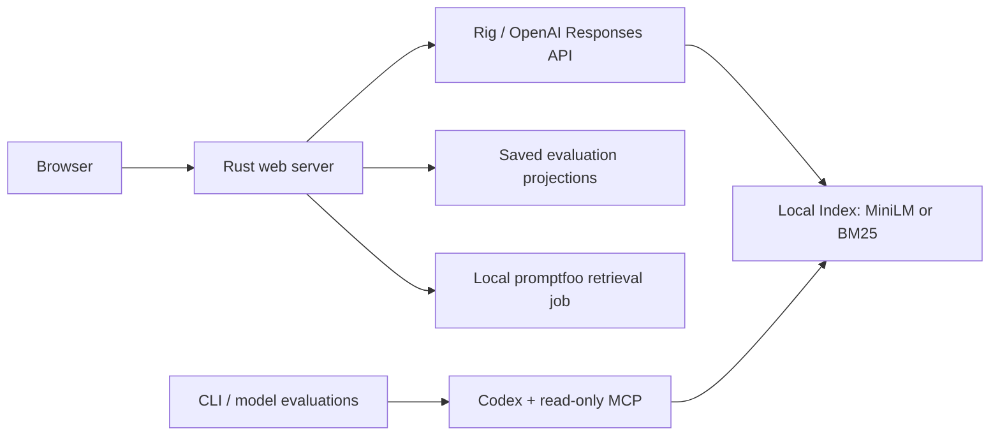

# Codebase guide

This guide explains the current website and the boundary between new model answers and saved evaluations. Start with the [interactive code tour](code-tour.html); use the [runtime report](runtime-report.md) for dated verification and known limitations. [Local setup](LOCAL_SETUP.md) covers installation, [privacy](privacy.md) covers data handling, and [the evaluation index](../evals/README.md) routes experiments.

## One website, separate execution paths



The application is Rust. Browser assets remain JavaScript/HTML/CSS; owned evaluation tools are TypeScript. Node.js and Codex are not website dependencies. Evaluation modules remain in the same Rust crate through `#[path]` declarations, while their source and evidence live under `evals/`.

[`main.rs`](../src/main.rs) starts `serve` by default, loads the live corpus/index and passes it to [`web::serve`](../src/web.rs). `WebState` binds to loopback, port 8766 unless `COA_PORT` overrides it. Assets are embedded with `include_str!`; changing one requires rebuilding and restarting. There is no general file server exposing the checkout or raw experiment directories.

| Route | Behavior |
| --- | --- |
| `/` | Live demo: fictional sources, a free-text question, answer and actual search actions. |
| `/demo`, `/demo/` | HTTP 308 redirect to `/`. |
| `/techniek/` | Human explanation of the architecture. |
| `/resultaten/` | Three local retrieval tests plus separately opened saved results. |
| `/api/session`, `/api/runs`, `/api/runs/{id}` | Create a session, submit a question, poll its run. |
| `/api/evals/rag` | Read the curated saved promptfoo projection. |
| `/api/evals/rag/catalog`, `/api/evals/rag/runs` | Read the fixed local test catalog; start/read/cancel an owned local evaluation job. |

Hosting adds a separate route allowlist; the local evaluation worker is not a supported public endpoint. See [deployment](public-deployment.md).

## Trace one question

[`demo.js`](../static/site/demo.js) creates a session, posts a question and polls its run. `POST /api/runs` captures the question, `answer_language` (`nl`/`en`, default `nl`) and `retrieval_method` (`dense`/`bm25`, default `dense`) before starting background work. Invalid enum values return HTTP 422. Later selector changes apply only to new questions; replay retains the original context.

[`ResponsesRunner::run`](../src/responses.rs) delegates model/tool steps to Rig in [`rig_runtime.rs`](../src/responses/rig_runtime.rs). The agent registers only the typed `SearchTool`, native structured-answer schema and `RunPolicy` hooks. Rig owns the agent loop; COA does not run a second competing loop.

The request goes to OpenAI's Responses API with `gpt-6.1-sol`, reasoning `low`, service tier `default` and `store: false`. The web prompt shares language, source and prompt-injection rules with [`codex.rs`](../src/codex.rs); the question is a separate input data item. The only model tool is `search_document(query, top_k, search_goal)`. It cannot access shell, arbitrary files, URLs, web search, Codex or a code-mode host. This is local function calling, without MCP transport in the web path.

The first model call must perform a real source search. The model can then make focused follow-up searches. `search_goal` is a public one-line task label, 1–80 characters, supplied by the model for that executed action; it is not private reasoning or a result claim. It is added to web JSON only after source/answer validation. Older runs and the shared Codex tool-call schema do not receive invented goals.

The fixed callback invokes [`Index::search_for_method`](../src/lib.rs). A mutex protects the shared index only during the short local `spawn_blocking` search; model HTTP requests wait independently. The website does not start ten model copies or ten Codex processes. The selected search method is server context and cannot change between tool calls.

Rig preserves original input/output items for subsequent calls, including encrypted reasoning, assistant phases and matching `function_call_output`, without `previous_response_id`. This replay exists only in the run's RAM; raw/encrypted reasoning is absent from public records. Only the final answer is interpreted as the answer. Refusals, incomplete responses, unknown tools, malformed arguments and invalid final JSON fail the run.

`validate_retrieved_answer` checks that source IDs, dates, manifests and exact citation text agree with passages actually returned. Repeated section IDs are namespaced by document. This proves provenance, not that every conclusion follows from the evidence. Missing evidence and honest unknowns remain possible even when the run completes.

## Bound transport and spending

[`BoundedTransport`](../src/responses/transport.rs) implements Rig's `HttpClientExt` and enforces the application policy before the codec. Original generation bytes are sent unchanged. Redirects, streaming and multipart are disabled on this route; invalid typed tools fail through a hook.

| Limit | Current contract |
| --- | --- |
| Whole run | One 120-second deadline, including counting, body reads and retrieval. |
| Tool work | At most four searches; after the fourth, tool choice is `none`. |
| Model work | At most five generations and five free exact input-token preflights; no automatic retries. |
| Tokens per generation | At most 300,000 counted input tokens and 4096 output tokens, including reasoning. |
| Bodies | 512 KiB provider response, 1 MiB serialized request context, 16 KiB count response. |
| Search input | Query 1–1000 characters; top-k 1–6; tool arguments at most 16 KiB; unknown fields refused. |

Each attempt receives a durable, atomic reservation in the schema-2 budget **before** input counting. The count includes all token-bearing fields, tools, schema and encrypted replay; unknown fields or invalid counts stop generation. Model, Standard pricing tier, `30m` cache policy and output ceiling stay fixed. Missing/corrupt/replaced/unwritable state fails closed. Restarts preserve usage; the same budget cannot be opened concurrently. [`demo_budget.rs`](../src/demo_budget.rs) owns this policy; [setup](LOCAL_SETUP.md#token-and-price-assumptions) records price assumptions and initialization.

`ResponsesRunner::from_env` reads `OPENAI_API_KEY` or an explicit external `COA_OPENAI_API_KEY_FILE`. The file must be regular, owned by the user, without links or group/other access, and bounded to 4096 trimmed bytes. Public configuration exposes neither key nor path. Missing setup permits source/result browsing with answers unavailable, without a Codex fallback. `runtime_ready` means configured, not proven quota or credit. The debug-only loopback mock uses a fixed fake key and does not read a real one; release builds refuse that override.

New run metadata identifies `provider: openai`, `transport: responses_api`, `runtime: rig-0.46.0` and matching `client_version`. Successful runs sum available usage across provider requests; reasoning tokens are part of output. Missing usage remains unknown. Failed runs may already have incurred charges. These records are not a billing ledger, and a local timeout cannot guarantee provider cancellation.

## Corpus and retrieval contracts

[`CorpusId::DemoTwelve`](../src/corpus.rs) selects twelve documents, six sections each, with reference date **13 November 2026**. The first ten preserve `ExpandedTen` bytes; Schaken and Naaicafé have their own source IDs/dates. CLI `search`/`ask` defaults and legacy evaluations still use the original five documents unless a corpus is selected explicitly:

```sh
cargo run --locked -- search --corpus demo-twelve 'Wanneer kan ik schaken?'
```

The parser accepts at most twelve documents and rejects missing/duplicate IDs, invalid dates, empty headings/sections and duplicate section IDs within a document. Each passage retains document ID, section ID, title, heading and source date. Source dates are distinct from observations of available places; a schedule never proves current capacity.

The local quantized multilingual MiniLM model uses fastembed 7.1.2, 384 dimensions and a 512-token input ceiling. Original MiniLM input is title, newline, heading, newline and exact section text, without prefixes. The index keeps document vectors in memory. Manifests record source/corpus hashes, exact embedding inputs, vector hashes and model/encoding identity. Mutable upstream model downloads and platform differences prevent a promise of bit-identical future embeddings.

`dense` ranks by cosine similarity. BM25 uses title, heading and full section text, Unicode words, k1=1.2, b=0.75 and no stemming. A BM25 query does not embed its text; the shared website index still loads MiniLM on startup to retain the established index identity. Dense hits expose `similarity`, BM25 hits `bm25_score`; neither is a probability or calibrated no-match threshold. The runner rejects mixed or unexpected methods and publishes the actual method only after validation.

The retrieval lab additionally offers RRF/weighted hybrid methods and document/SQLite profiles. Both stores feed the same canonical sections and exact f32 vectors to the same Rust scorer; SQLite is a storage/cache comparison, not a separate SQL vector or FTS ranker. Activity expansion adds whole related sections under a context ceiling. Typed user filters cannot come from expectations or case IDs; unknown source fields remain unknown. [Retrieval procedures and metrics](../evals/rag/docs/retrieval-lab.md) give the full contract.

## Sessions, concurrency and network limits

A semaphore allows ten active model questions; the eleventh gets HTTP 429 without a hidden queue. Each session can have only one pending run. The permit is released on completion, failure or timeout. `RunStore` uses random 256-bit session tokens and limits RAM to 256 sessions, 40 runs per session and 256 total runs. Each run is at most 256 KiB serialized, reserving space for assessment metadata.

Sessions expire 30 minutes after creation or the latest started question. API access performs cleanup; pending runs are protected and polling does not extend the lifetime. Capacity eviction removes only inactive sessions/completed runs after input validation. Dynamic API responses, including errors/reports, use `Cache-Control: no-store`. Restart removes application RAM, not swap, downloads or provider copies.

[`DemoLimits`](../src/demo_limits.rs) limits each network address to ten started model questions/hour and thirty new sessions/ten minutes, plus five seconds between starts in one session. Start and replay share the limit; new tabs/sessions do not reset the address counter. Rejections start no model attempt and include HTTP 429 plus `Retry-After` where a remaining wait is known. Capacity rejection has no predicted wait.

Identity comes from the TCP peer, normalizing IPv4-mapped IPv6 and IPv6 to /64. `X-Forwarded-For` is ignored. Only an exact `COA_TRUSTED_PROXY_IP` peer may supply a single valid `X-Real-IP`; missing/invalid values are refused. The proxy must overwrite the header. Counters hold at most 4096 addresses in RAM, are not written to run records/reports/logs, and expire on subsequent checks or restart. A full table refuses a new address. Shared wifi shares limits; this is neither user identity nor an account-wide spending cap.

## Browser behavior

The demo shows compact expandable activities, one question, the literal answer and inspected search actions. Each action retains its exact query, ordered hits and any repeated passages. Citation highlights refer to the same document, date and section. IDs, top-k, similarity scores and internal statuses are not displayed as answer content. There is no separate unknowns list or judgment flow; backend fields remain available.

The language menu selects Dutch/English UI and the language of **new** answers. `localStorage['coa-demo-language']` stores the preference; unknown/blocked storage falls back safely. `sessionStorage['coa-test-session']` stores the current session ID. Changing language sends no model/search request and preserves question text, opened sources and existing answers. Source paragraphs and exact quotes remain Dutch. Activity names and section headings are translated screen labels. Shared navigation/footer follow the preference; the explanatory page has its own authored content.

## Retrieval tests and saved results

The three local browser tests use P01/T02/T05 on the original five activities, top-k 5, candidate-k 30, context ceiling 1200 and `documents_sections`. Their encoder choice is real MiniLM or multilingual E5 Small, with E5 `query: ` / `passage: ` prefixes; BM25 loads no encoder. The twelve-document demo has no newly invented gold benchmark.

[`eval_jobs.rs`](../src/web/eval_jobs.rs) runs only the fixed promptfoo browser configuration and source assertions. Start/cancel requires loopback without forwarded headers, valid Host/Origin and an owned session. One heavy job at a time, no queue, 300 seconds, sixty starts/hour and five/minute per address bound local work. Fixed argv and a cleaned child environment prevent request input from choosing commands, paths, model URLs or a model-generation route. PID/start identity protects detached-child cleanup. Raw output stays under ignored `results/local/browser/`.

Promptfoo controls RAG questions/configurations/repetitions/assertions; Rust performs local retrieval or explicitly bounded Codex sessions. Protected expectations are loaded only by assertions. [`run_promptfoo.mjs`](../evals/rag/scripts/run_promptfoo.mjs) exports a public allowlist projection, excluding raw configs, machine paths, credentials and private reasoning. Source quality, N/A and execution failures stay distinct. Native retrieval time and promptfoo elapsed time have different labels.

The historical sixty sessions use `strengthened-10-20261106`, ten questions, Sol/Luna and three repetitions, both with dense retrieval over sixty sections. Model/repetition selection reads saved records and starts nothing. Six earlier aborted attempts stay separate. Source completeness is not answer correctness.

[`export_site_results.ts`](../evals/rag/scripts/export_site_results.ts) validates sealed source artifacts, record hashes and native assessments before exporting questions, valid alternative source combinations, fictional source text, model/repetition, observed searches and completion timing. It excludes raw reasoning, prompts, authentication and local paths. Browser text is inserted as text nodes; only retrieved expected support receives a success mark, and other hits are not automatically wrong.

```sh
node evals/rag/scripts/export_site_results.ts --experiment-dir /path/to/existing/frozen/run
node --test evals/rag/scripts/export_site_results.test.ts
```

Exporting/reassessing saved records makes no model calls. New web answers do. Expectations never enter the live prompt, search index or stop decision. Complete-assistant generation/judging remains separately documented under [evals/coa-assistent](../evals/coa-assistent/README.md).

## Recent architectural changes

| Date | Change |
| --- | --- |
| 2026-11-17 | Policy 2 binds durable schema-2 reservations to exact input counting and fixed token/model/tier/cache limits. |
| 2026-11-16 | Three bounded local promptfoo retrieval tests with real MiniLM/E5 selection added to the results page. |
| 2026-11-13 | RAG orchestration moved to promptfoo; evaluation source/data/evidence grouped under `evals/`. |
| 2026-11-13 | Live corpus grew to twelve activities; frozen five-/ten-document evaluations stayed unchanged. |
| 2026-11-13 | Rig 0.46.0 took over web model/tool/history handling; bounded transport and application source guards remained. |
| 2026-11-10 | Website switched to direct Responses API; Codex/MCP remained the CLI/evaluation route. |

Dependencies: [Rig 0.46.0](https://github.com/0xPlaygrounds/rig/releases/tag/v0.46.0), published **31 October 2026**; [fastembed 7.1.2](https://github.com/anush008/fastembed-rs/releases/tag/v7.1.2), published **19 October 2026**. Only Rig's agent library is enabled; terminal-agent shell tools, memory storage and its embedding adapter are not part of this integration. Dated verification belongs in the [runtime report](runtime-report.md), not an implied permanent quality or capacity guarantee.
