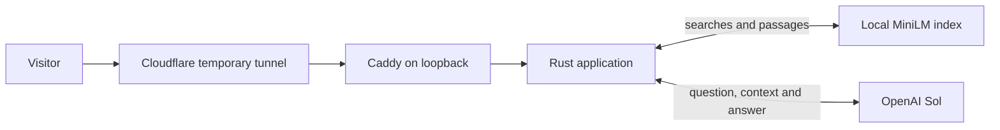

# How the COA Assistent demo runs

This independent prototype helps a staff member explore activities with a resident. Its twelve activity descriptions are fictional. A visitor asks a question, the assistant searches those descriptions, and the page shows an answer with its cited passages. Participation remains voluntary; the application does not update resident records, send messages or register anyone.

The key distinction is between **finding information locally** and **writing an answer remotely**. A small multilingual model on the server finds related text. OpenAI Sol receives the question and retrieved text, decides whether another search would help, and writes an answer. Local embeddings do not make the complete service local.

This report describes source revision `5ac52ee`, inspected on **18 November 2026**, and the recorded public launch on **17 November 2026**. Launch measurements are historical observations, not a fresh capacity test. Operational instructions live in [local setup](LOCAL_SETUP.md) and [public deployment](public-deployment.md).

## A small server with an external answer model



A Cloudflare Quick Tunnel opens an outbound connection from the server and forwards requests to Caddy on `127.0.0.1:9899`. Caddy forwards allowed routes to Rust on `127.0.0.1:8766`. Cloudflare handles public HTTPS. The temporary address changes when the tunnel process restarts; this demonstration link has no service-level guarantee. [Cloudflare documents these limitations](https://developers.cloudflare.com/tunnel/get-started/quick-tunnels/), updated **30 September 2026**, checked **18 November 2026**.

The launch used one Ubuntu 24.04 x86_64 VPS with two virtual CPUs and approximately 3.7 GiB RAM. A private Linux compatibility check recorded on 17 November loaded MiniLM and ran one dense retrieval over the twelve-source corpus in **9.11 seconds**, with a **947 MiB** peak resident-memory measurement. It made no provider calls. This was a cold-start CLI check, not HTTP server startup, answer latency or sustained-traffic capacity. The [systemd service](../deploy/coa-demo.service) runs under a separate account with a 1536 MiB memory limit.

The Rust release embeds the website, fictional documents and selected saved evaluation assets. The website needs no Node.js or Codex installation on the server. Node.js and TypeScript belong to separate evaluation tooling. MiniLM model files are cached on disk; document embeddings are rebuilt in RAM at startup. The ordinary web path has no persistent document or vector database.

The [public proxy configuration](../deploy/Caddyfile.quick-tunnel.app) allows source reading, saved results, session creation and questions. It excludes local evaluation workers, replay, judging, criteria and report export. The same application also contains research tools intended only for local use.

## Follow one gardening question

Take **“Where and when can I garden?”** This follows the real implementation; it is not a newly executed model answer.

At startup, [`main`](../src/main.rs) selects `demo-twelve`. [`Index::load_for_corpus`](../src/lib.rs) parses twelve documents into 72 sections. Each retains its document ID, heading and source date. MiniLM embeds the document title, heading and exact section text into a 384-number vector. Sections and vectors stay in process memory.

The [browser](../static/site/demo.js) sends the question, answer language, search method and `top_k: 3` to `POST /api/runs`. The [web handler](../src/web.rs) checks the session and limits, saves a pending run in RAM and starts asynchronous work. The browser receives a run ID and polls for completion.

[`ResponsesRunner`](../src/responses.rs) hands the question to the [Rig agent](../src/responses/rig_runtime.rs). Rig owns the model/tool loop; the application supplies one tool, `search_document`. A policy hook requires a search before an answer. That tool invokes a Rust callback against the shared index. The web route uses no Codex subprocess or MCP connection.

Meaning-based search embeds the search query locally and ranks sections by cosine similarity. The alternative web method, BM25, ranks matching words. Both return ordinary source text with document, section and date information. Sol receives those passages, **not the vectors**. It can request a focused search if the first results omit the garden address. It can still miss it: the recorded 13 November Rig smoke test did exactly that and left the precise address unknown.

The gardening source records Tuesday 10:00–12:00 in `S2` and a fictional location in `S3`. Its availability observation in `S6` is dated 1 September. The document's 20 October publication date does not make that availability current. See the unchanged [fictional gardening document](../fixtures/document.md).

Before success, [`validate_retrieved_answer`](../src/codex.rs) checks the structured answer and citations against actual search results. A quote must occur literally in a retrieved section with the same document ID, section ID and source date. The web handler also checks the returned corpus manifest and search method against the run's original context.

These checks establish provenance. They do not prove that every sentence is correct, that the activities fit a person, or that every relevant passage was found. Visitors can inspect cited passages and recorded searches; a staff member still checks the answer and discusses options with the resident.

## Bounds around each question

The current runtime allows ten questions concurrently and one active question per visitor network across all its sessions. A further question receives a capacity or rate-limit response. Address and session limits also constrain repeated use.

A question has at most four sequential searches, five model attempts and a 120-second deadline. Each attempt allows at most 4096 output tokens. Before generation, the [transport](../src/responses/transport.rs) reserves an attempt in the persistent budget and asks OpenAI to count the full input, including instructions, tools, schema and accumulated context. An unknown, invalid or greater-than-300,000-token count blocks generation. The accepted generation payload is then sent unchanged. Automatic HTTP retries are disabled.

OpenAI's [complete-input counting endpoint](https://help.openai.com/en/articles/4936856-understanding-and-counting-tokens) is free; generation is billed separately. The help article was updated approximately **5 November 2026** and checked **18 November 2026**. Five attempts can therefore mean up to five counting requests plus five generation requests. A failed count or provider error still consumes the reserved attempt.

The public launch configured **50 attempts in total**, preserved across restarts in a schema-2 budget file outside the release directory. At the [Standard Sol prices](https://developers.openai.com/api/docs/pricing) checked **18 November 2026** (HTTP Last-Modified **18 November 2026**), the conservative upper rates applicable here are $5 per million input tokens including a 30-minute cache write, and $15 per million output tokens:

```text
50 × (300,000 × $5 + 4,096 × $15) / 1,000,000 = $78.072
Including one 20% planning margin: $93.6864
```

This conditional calculation concerns this application's configured release. It is not a provider-side $100 spending cap, an account-wide billing guarantee, or a statement of remaining quota. Different prices, models, cache settings or other key usage require a new calculation. Stopping prevents new requests but cannot undo work already accepted by the provider.

## What persists, and who receives the text

The API key is outside the repository, readable only by the application account (`0600`); the budget directory is private (`0700`). Missing, damaged, replaced or concurrently opened budget state blocks new paid work. Restarting does not issue a new allowance. The [budget](../src/demo_budget.rs) stores counters and policy information, not questions or answers.

The [RAM run store](../src/runs.rs) holds visitor questions and results, bounded by 256 sessions, 256 runs in total and 256 KiB per run. Inactive sessions expire after 30 minutes when cleanup next runs, and pending work is preserved until completion. A restart clears this in-memory history. The optional [private SQLite trace store](traces.md) keeps questions, model and search events, and results until the owner explicitly authorizes deletion. Provider records, downloads, swap and backups have their own retention.

OpenAI processes the question and selected passages. Cloudflare handles public-route traffic. `store: false` disables Responses application storage; it does not promise zero provider retention. Private model reasoning and raw provider diagnostics are excluded from public results. These boundaries require fictional data only; they do not certify resident-data processing or provide organizational authorization.

## Evidence, with its limits

Deterministic tests cover tool restrictions, citation binding, input counting, persistent attempt reservation, failure handling, session isolation and the ten-question limit using local mock providers. Their presence is not a claim that they were rerun for this report.

The recorded 13 November Rig smoke test completed three fictional questions on twelve sources using ten provider requests. It demonstrated runtime compatibility and exposed the missed garden address. Earlier saved comparisons used Codex and older corpora; they do not measure this Rig release's answer quality. Human calibration remains unfinished. The [evaluation guide](../evals/README.md) separates retrieval evidence from full-assistant assessment.

The [code tour](code-tour.html) follows the implementation in more detail; the [architecture guide](CODEBASE_GUIDE.md) describes the current components. A successful smoke test or static configuration review does not establish sustained public capacity, complete semantic correctness or a dynamic security audit.
